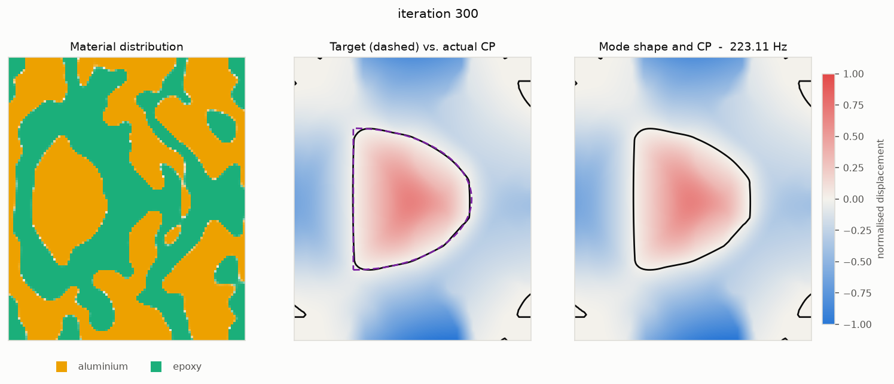
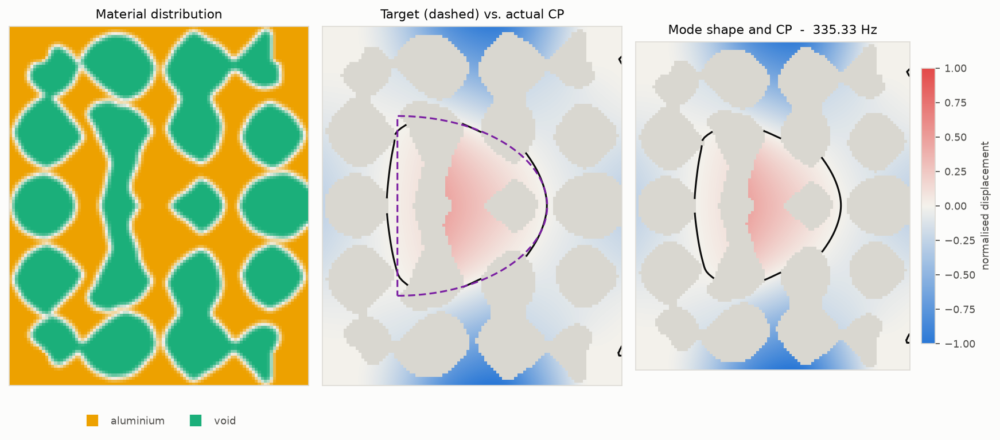
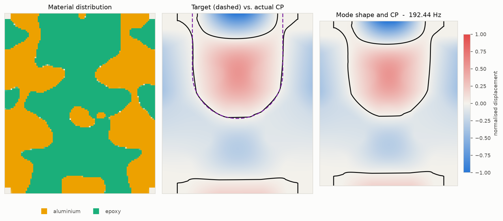
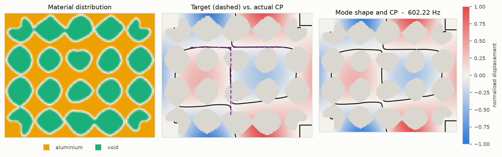
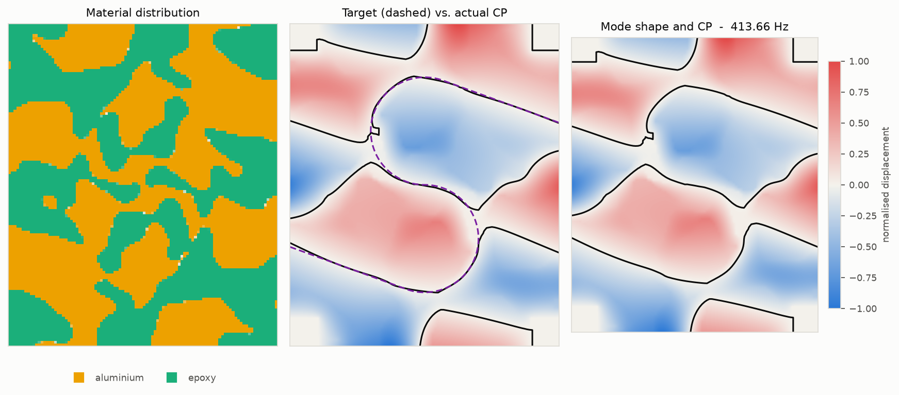
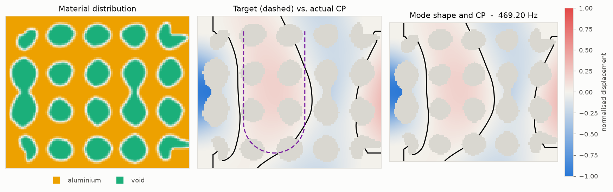
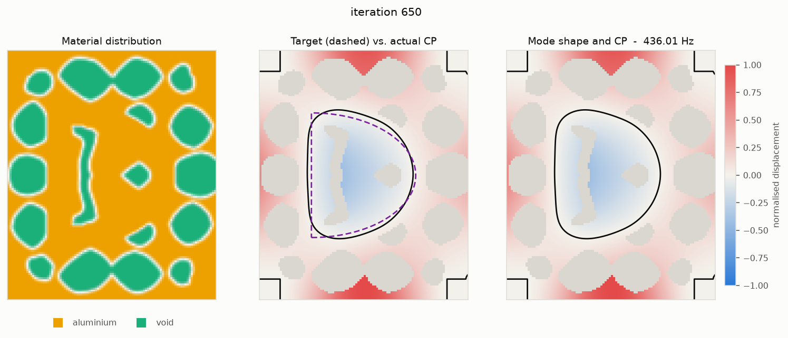
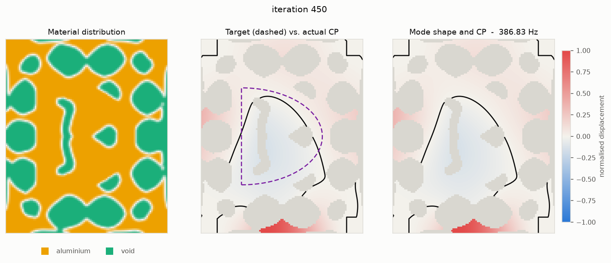

# Chladni-pattern topology optimization

A Python reimplementation of

> L. Xue, G. Wen, F. Wang, N. L. Pedersen, *Topology optimization design of
> Chladni patterns for vibration mode manipulability*, Acta Mechanica Sinica
> **40**(4), 423445 (2024). [doi:10.1007/s10409-023-23445-x](https://doi.org/10.1007/s10409-023-23445-x)

focused on the paper's **single-mode** case (Section 4.1): design a bi-material
plate so that the nodal lines — the Chladni pattern — of one chosen vibration
mode trace a prescribed shape.

```
pip install -r requirements.txt

python examples/case1_letter_D.py --quick   # 50 x 60 preview, a few minutes
python examples/case1_letter_D.py           # the paper's 100 x 120 mesh
python examples/open_curve.py --shape u    # an open U hanging from the top edge
python examples/open_curve.py --shape s    # an open S running edge to edge
python examples/sweep_modes.py --shape s   # try every carrier mode, ranked
python examples/levelset_letters.py --shape d --quick   # level-set method (Wang 2003)
python -m pytest tests/                     # verification suite
```

Besides the paper's material-distribution approach, the package carries a
**boundary-geometry** approach: the level-set method of Wang, Wang & Guo
(2003), which cuts holes in a single-material plate. See
[Level-set method](#level-set-method-wang-et-al-2003).

The papers themselves are not in this repository; see the citations above
and in the level-set section.

Runs use AdamW. MMA, the paper's optimizer, is kept in the package
(`OptimizerConfig(method="mma")`) but gives worse results on this problem; see
[Optimizers](#optimizers).

## Results at a glance

Each figure shows the design, the target (dashed) against the actual nodal
line, and the mode shape. More are written by every run under `results/`,
which is not tracked: rerun the examples to regenerate them.

| Density method (the paper's) | Level-set method (Wang 2003) |
|---|---|
|  |  |
| Letter D on mode 5, aluminium/epoxy | Letter D on mode 5, holes in aluminium |
|  |  |
| Open U hanging from the top edge, mode 6 | Liang's T stroke on mode 9 |
|  |  |
| Open S edge to edge, mode 13 | Liang's U on mode 7: fails at full resolution |

## Seeing the result

A run writes `results/case1/`:

| file | what it is |
|---|---|
| `design.png` | material layout, target vs. actual pattern, mode shape + nodal lines |
| `history.png` | objective and constraint indicators, volume fraction, frequency evolution |
| `selection.png` | the controlled areas, i.e. Fig. 2(b) |
| `design.npz` | design fields, the final mode, and the target curves |
| `history.json` | every iteration's objective, constraints, frequencies and MAC |

A paper-resolution run takes roughly an hour, so it does not make you wait for
them: `--checkpoint N` (default 25) refreshes `design.png`, `history.png` and a
reloadable `checkpoint.npz` every `N` iterations, starting at iteration 1. Open
`design.png` in any viewer that reloads on change and watch the nodal line move
onto the target. Pass `--checkpoint 0` to switch it off.

To re-render from a saved run without recomputing anything:

```
python examples/plot_result.py results/case1           # finished run
python examples/plot_result.py results/case1 --show    # open a window
python examples/plot_result.py results/case1/checkpoint.npz -o /tmp/peek
```

The target curves are stored inside the `.npz`, so a result replots on its own
without rebuilding the problem. For a custom figure, the pieces in
`chladni_topopt.postprocess` (`plot_material`, `plot_mode`, `plot_selection`,
`plot_indicators`, `plot_volume`, `plot_frequencies`) each take an `ax` and a
swappable `PlotTheme`.

## What the method does

A plate's mode shapes follow from its material layout, so choosing the layout
chooses the pattern. Two areas are marked around the target curve (Fig. 2b of
the paper): the **shape area** `L`, a band on the curve itself, and the
**surrounding area** `L̃`, a band on either side of it separated by a gap. Two
indicators measure the mode's amplitude over an area,

```
Avg(L, φ) = Lᵀ(φ∘φ) / ΣL              Var(L, φ) = Lᵀ((φ∘φ) − μ)² / ΣL
```

and Eq. (15) pushes the amplitude down on the curve and up — uniformly — around
it, which is exactly the condition for a nodal line to lie along the curve:

```
min  C  = Avg(L̃, φ⁰) / Avg(L̃, φ)
s.t. g₁ = Avg(L, φ)  / Avg(L, φ⁰)  ≤ ε      (ε = 0.01)
     g₂ = Var(L̃, φ) / Var(L̃, φ⁰) ≤ τ      (τ = 0.40)
     g₃ = V − V* ≤ 0
```

Everything is normalised by the initial design's indicators `φ⁰`, so each term
starts at 1. Gradients come from a bordered adjoint (below). The design is
updated with AdamW by default, or with MMA as in the paper (see
[Optimizers](#optimizers)).

## Layout

Every stage is a `typing.Protocol` with a one- to three-method surface, and
`ChladniAnalysis` / `TopologyOptimizer` only ever see the protocol. Replacing a
component is writing one class and passing it in — no subclassing, no edits to
the driver, no registry.

| Module | Protocol | Shipped implementations |
|---|---|---|
| `mesh.py` | — | `StructuredQuadMesh` |
| `elements/` | `ElementFormulation` | `MindlinQ4` (MITC4 / reduced / full shear) |
| `bc.py` | `BoundaryCondition` | `CornerClamps`, `ClampedEdges`, `SimplySupportedEdges` |
| `material.py` | `MaterialInterpolation` | `SIMPTwoMaterial` (Eq. 10), `SolidVoidErsatz` (level set) |
| `filters.py` | `Filter`, `Projection` | `DensityFilter` (Eq. 12), `ExponentialThreshold` (Eq. 11), `IdentityFilter` |
| `eigen.py` | `EigenSolver` | `ShiftInvertEigen` |
| `linalg.py` | `Factorizer` | `PardisoFactorizer` (default when installed), `SuperLUFactorizer` |
| `tracking.py` | `ModeTracker` | `MACTracker` (Eq. 19), `FixedIndexTracker` |
| `indicators.py` | `Indicator` | `Average` (Eq. 13), `Variance` (Eq. 14) |
| `formulations.py` | `Formulation` | `ConstraintFormulation` (Eq. 15), `MultiObjectiveFormulation` (Eq. 21) |
| `sensitivity.py` | `SensitivityAnalysis` | `AdjointEigenvectorSensitivity` (Eqs. 16–18) |
| `optimizers/` | `Optimizer` | `AdamW` (augmented Lagrangian, default), `MMA` (Svanberg 1987), `HamiltonJacobi` (level set) |
| `levelset/` | `Filter`, `Projection`, `Reinitializer`, `Optimizer` | `NodalToElement`, `WangHeaviside` (Wang Eqs. 39–40), `ContourReinitializer`, `LevelSetUpdate` |
| `regularizers.py` | `Formulation` (wrapper) | `RegularizedFormulation` with `PerimeterTV`; `count_holes` for reporting |

`metrics.py` scores how well a result's nodal line matches the target (used by
`sweep_modes.py` and printed at the end of `open_curve.py` runs). `analysis.py` runs the forward problem, `driver.py` the loop of Fig. 3,
`config.py` offers a `build_problem(cfg)` convenience for the common wiring, and
`postprocess.py` / `io.py` handle figures and persistence.

Target shapes are deliberately *not* abstracted: `examples/shapes.py` returns
plain lists of `(N, 2)` point arrays in plate coordinates. Anything in that form
works — hand-drawn points, sampled SVG paths, a traced bitmap.

A target can be made of **closed loops**, **open curves**, or both. A nodal line
cannot stop in the middle of a plate — it closes on itself or ends on the
boundary — so an open curve should run all the way out to the edges.
`u_curve` hangs from the top edge: two straight arms meet the edge at right
angles and join in a semicircle. `letter_s` runs from the left edge to the
right edge, each end continuing along its own tangent to the edge so there is
no cusp. Both are open curves, used by `examples/open_curve.py --shape u|s`. The two kinds
differ in two ways. An open curve gets no closing segment. And "which side of
the line" means left/right of the curve (walking along its points), rather than
inside/outside.

```python
from chladni_topopt.selection import build_selection_vectors
loops = [np.array([[x0, y0], [x1, y1], ...])]     # closed loop, metres
curves = [np.array([[0.0, y0], ..., [lx, y1]])]   # open, edge to edge
sel = build_selection_vectors(mesh, dofs, loops, band=..., gap=..., surround=...,
                              open_curves=curves)
# or, through the config:
TargetConfig(loops=(), open_curves=curves, mode_index=2)
```

**The U works.** `python examples/open_curve.py --shape u` (100 × 120, AdamW,
mode 6) converges in 242 iterations with every constraint satisfied:
`Avg(L,φ) = 0.0068` (limit 0.01), `Var(L̃,φ) = 0.394` (limit 0.4), objective
1.51, volume fraction 0.45, at 192 Hz. The nodal line runs down both arms and
follows the rounded bottom closely. Three things differ from the target. The
last ~0.2 m of each arm flares out towards the clamped top corners, meeting the
edge near x = 0.25 and 1.75 rather than 0.5 and 1.5. A second, small nodal arc
sits just under the top edge inside the U. And another line runs along the
bottom edge; the formulation controls only the neighbourhood of the target, so
lines elsewhere are allowed.

**The paper's carrier for the U, mode 10, also works, but less cleanly.** The
paper's Case 2 puts the U on mode 10 of the plate turned sideways (2.4 × 2.0).
There, mode 10 has a nodal line hanging from the top edge, the same topology as
the U. `open_curve.py --shape u --plate sideways --mode 10` converges in 251
iterations with `Avg(L,φ) = 0.0042`, going from 400.7 Hz to 372.5 Hz (the paper
starts at 394.35 Hz). The full U outline forms, but an extra diagonal nodal line
crosses its interior and meets the left arm in an X-junction. On the *upright*
plate, mode 10 is a different pattern with no top-hanging line. That run also
"converges", with `Avg(L,φ) = 0.0088` at 317 Hz, but the lines only partly
follow the U and wander off to the bottom edge. It isn't a U. Upright mode 6
remains the cleanest U.

**Which mode should carry the target? Try them.** No cheap test on the plain
plate reliably predicts the right carrier, so `examples/sweep_modes.py` runs
the search. It applies the same short optimization to every candidate mode and
plate orientation, then ranks the results by how much of the target the final
nodal line actually traces (`chladni_topopt.metrics.nodal_line_fit`):

```
python examples/sweep_modes.py --shape s                  # modes 1-16, both plates
python examples/sweep_modes.py --shape u --modes 4-10 --plates upright
```

It writes `results/sweep_<shape>/summary.csv` and a `contact_sheet.png` of
every run's pattern in rank order. Runs already on disk are re-scored rather
than re-optimized, so an interrupted sweep resumes where it stopped. The metric
measures the line itself because the optimizer's own `Avg(L,φ)` can't be
trusted for this. That number has reported "converged and feasible" for
patterns that looked nothing like the target, by making the neighbourhood of
the curve quiet instead of putting a line along it.

What the searches found, and what didn't work:

- **The start-up amplitude score is misleading.** The example prints, for each
  mode of the uniform plate, how much amplitude it already has on the target
  band. It picked the wrong carrier for both shapes (mode 2 for the S, mode 4
  for the U).
- **"Same edges" topology is a useful hint, not a rule.** It found the U's
  mode 6, whose upper nodal line already hangs from the top edge. For the S it
  pointed to mode 3 (a single left-to-right line), and mode 3 failed: the ends
  ran into the top-left and bottom-right clamped corners. Clamped corners have
  zero displacement, so they are cheap places for nodal lines to end.
- **The S needs a high mode.** Sweeping modes 1–16 on both plate orientations
  (quick mesh, 150 iterations), modes 1–4 traced 0–13% of the S. Four carriers
  traced over 90%: upright 13 (97%), sideways 9 (92%), sideways 11 (91%) and
  sideways 13 (91%). A high mode has nodal lines to spare, and enough
  curvature to bend round both hooks and still run out to the side edges.

**The S works on upright mode 13** (`open_curve.py --shape s`, now the
default). At 100 × 120 it converges in 222 iterations with every constraint
met: `Avg(L,φ) = 0.0093`, `Var(L̃,φ) = 0.376`, objective 0.87, at 414 Hz. The
nodal line traces 96.6% of the target. It follows both arcs and both long tails
continuously from the left edge to the right edge. Two flaws: a small notch on
the upper arc's left side, where another nodal line touches it; and the S is
one of a family of roughly parallel nodal lines, normal for a 13th mode and
outside the controlled zone.

Sideways mode 11 scored almost as high (96.2% at full resolution) but is
visibly worse: neither tail reaches its edge. Each turns off about 0.3 m short
and closes into a cell, and the metric counts the tails as traced only because
other nodal lines pass nearby. So **`traced` checks that the target lies near
some nodal line, not that one continuous line follows it.** Use it to shortlist
candidates, then look at the pictures.

### Swapping a component

```python
class MyFilter:                                   # satisfies `Filter`
    def forward(self, x):          return ...     # x -> xtilde
    def backward(self, dc_dxtilde): return ...    # chain rule back to x

analysis = ChladniAnalysis(..., filter=MyFilter(), ...)
```

The same shape applies to any other row of the table. `build_problem` is a
convenience for the default wiring, not a required entry point — construct
`ChladniAnalysis` and `TopologyOptimizer` directly whenever it gets in the way.

## Implementation notes

**Element.** Reissner–Mindlin Q4 with `(w, θx, θy)` per node. Bending is
integrated 2×2; the shear term defaults to **MITC4** rather than the one-point
reduced integration implied by Eq. (3). Reduced integration leaves two hourglass
mechanisms per element (`test_element.py` shows 5 zero-energy modes instead of
3), which is harmless in a static problem but can surface as spurious modes in
an eigenvalue problem and derail mode tracking. Both schemes remain available
via `MindlinQ4(shear_scheme=...)`.

**Assembly.** Eqs. (8)–(9) factor `E` and `ρ` out of the element matrices, and
the mesh is uniform, so `ke0`/`me0` are built once and each assembly is a
scatter-add of rescaled copies with precomputed indices. Constrained DOFs are
dropped at the triplet stage rather than by slicing the assembled matrix.

**Adjoint (Eqs. 16–18).** For a response `C(φ, λ)` with `R₁ = (K − λM)φ` and
`R₂ = (φᵀMφ − 1)/2`, stationarity of `C + uᵀR₁ + vR₂` gives

```
[ K − λM   Mφ ] [u]   [ −∂C/∂φ ]
[   φᵀM     0 ] [v] = [  ∂C/∂λ ]

dC/dx̄ₑ = uᵀ(∂K/∂x̄ₑ − λ ∂M/∂x̄ₑ)φ + (v/2) φᵀ(∂M/∂x̄ₑ)φ
```

`K − λM` is singular on its own — `φ` spans its null space — so the bordering is
what makes the system solvable. It is the same matrix for every response of a
mode, so it is factorised once per iteration and back-substituted three times.
This matches the paper's Eqs. (16)–(17) up to their factor-of-two scaling of
`u, v`; the convention here is pinned down by finite differences in
`tests/test_sensitivity.py`, not assumed.

In the variance gradient the `∂μ/∂φ` term cancels exactly, because
`Σᵢ Lᵢ(φᵢ² − μ) = 0` by the definition of `μ`:

```
∂Avg/∂φ = 2(L∘φ)/ΣL        ∂Var/∂φ = 4(L∘φ∘(φ∘φ − μ))/ΣL
```

**Selection vectors.** Only the transverse DOF of each node is selected, and
constrained nodes are excluded — their displacement is identically zero, so
including them would bias both indicators for reasons unrelated to the design.

**Mesh-relative lengths.** The filter radius and the three zone widths are
stored in *element widths*, as the paper states them (`rmin = 4`). `coarsen()`
therefore divides them by the same factor it divides the mesh by; keeping them
at a fixed element count while coarsening would quietly quadruple the physical
smoothing radius and change the problem. This matters a lot in practice — it is
the difference between `Avg(L,φ)` reaching 0.05 and stalling at 0.6.

## Optimizers

`OptimizerConfig(method="adamw" | "mma")` picks the update rule. Both satisfy
the same `Optimizer` protocol, so the driver does not know which one it has.

**AdamW** is unconstrained, and this problem has three inequality constraints
and a `[0, 1]` box, so `optimizers/adamw.py` adds two pieces:

- **Bounds** by projection: every step is clipped back into the box.
- **Constraints** by a Powell–Hestenes–Rockafellar augmented Lagrangian. Adam
  descends on `f₀ + Σᵢ (max(0, λᵢ + ρgᵢ)² − λᵢ²) / 2ρ`, and every
  `dual_interval` steps the multipliers update as `λᵢ ← max(0, λᵢ + ρgᵢ)`.

Three settings behave differently from their textbook defaults:

- **Step-size decay.** Adam normalises each coordinate's step, so near a
  solution the step does *not* shrink. At a constant rate the iterates keep
  circling the optimum at a radius of about `lr`, and the multipliers move with
  them. The rate therefore decays geometrically,
  `lr_t = max(lr_min, lr · lr_decay^t)`. The defaults take it from 0.02 to
  0.002 over about 600 iterations.
- **`lr` plays the role of MMA's move limit.** Adam's normalised step is about
  `lr` per variable, per iteration.
- **Weight decay is off.** AdamW's decay pulls every variable towards 0, which
  here means "towards epoxy", a bias with no physical reason.
  `weight_decay` and `decay_target` are exposed if you want a regulariser, for
  example decay towards 0.5.

**MMA** is what the paper uses. Its convex subproblem handles the constraints
exactly at every step instead of through slowly adapting multipliers.

Head to head on the quick problem (50 × 60, same setup, 150 iterations). Each
row is **three runs** from the same start: one unperturbed, and two nudged by
±1e-9. Optimization trajectories amplify round-off, so two runs differing only
at that level end at visibly different designs, and a single run per setting
cannot separate settings. Ranges are min–max over the three runs
(`results/adamw_trials/seeds.py`, `seeds.log`).

| | `Avg(L,φ)` ratio (≤ 0.01) | `Var(L̃,φ)` ratio (≤ 0.40) | objective | volume |
|---|---|---|---|---|
| MMA, `move = 0.1` | 0.050–0.061 | 0.377–0.393 | 0.84–0.86 | 0.52–0.53 |
| AdamW, `lr = 0.02` (default) | 0.030–0.031 | 0.297–0.339 | 1.13–1.21 | 0.53–0.54 |
| AdamW, `lr = 0.05` | 0.033 | 0.302–0.419 | 1.01–1.08 | 0.54 |

What survives the spread:

- **AdamW vs MMA.** AdamW ends with `Avg(L,φ)` about half of MMA's, and its
  objective above 1 where MMA's is below. Both gaps are several times the
  run-to-run spread. Neither optimizer reaches `ε = 0.01` in 150 iterations.
- **`lr = 0.02` vs `0.05`.** The larger step recovers some objective (1.01–1.08
  against 1.13–1.21) for a slightly higher `Avg(L,φ)` (0.033 against 0.030).
  The ranges don't overlap, but the differences are small.

What does not: the variance ratio at `lr = 0.05` ranges from comfortably
feasible to over its limit (0.419) across runs that differ only by round-off. An
earlier single-run `lr = 0.01` trial (`compare.log`) is not repeated here, and
its apparent differences from `lr = 0.02` were within this spread. None of the
runs switched modes.

On the quick mesh the `L` band is floored at one element, 0.04 m, for which
`linear_profile_shape_ratio` gives 0.038. AdamW finishes *below* that number,
by letting the surrounding amplitude fall — which is exactly why its objective
ends above 1. See "Tuning notes" below for what that estimate does and does not
claim.

## Performance

**A GPU (or JAX) would not speed this up.** Profiling one iteration on the
paper mesh (35 211 free DOFs) shows where the time goes:

| stage | share |
|---|---|
| eigensolve — shift-invert Lanczos, which is mostly sparse factorization and triangular solves | ~63% |
| adjoint — factorizing the bordered `[K−λM, Mφ; φᵀM, 0]` system | ~12% |
| everything a GPU parallelizes well: assembly, filter, element `einsum`s, indicators | ~2% |

About 87% is sparse direct factorization and triangular solves: irregular,
memory-bound work that GPUs handle poorly at this size, and for which JAX has
no solver at all (`jax.scipy.sparse.linalg` has only iterative methods, and
there is no sparse eigensolver). The problem also needs float64, and a consumer
card like the GTX 1650 Ti runs FP64 at 1/32 of its FP32 rate — slower than the
CPU. Going dense doesn't rescue it: the 35k × 35k matrix is 9.9 GB, and a dense
eigensolve is far more work. Autodiff doesn't help either, since
differentiating through a sparse eigensolve still needs the same hand-written
adjoint. A GPU starts paying off at millions of DOFs with matrix-free
multigrid, on a datacenter card with full-rate FP64 — a different problem.

**What does help is on the CPU.** `examples/benchmark_solvers.py` times real
AdamW iterations stage by stage. Paper mesh, idle i7-10750H (6 cores / 12
threads), seconds per iteration:

| configuration | eigen | adjoint | per iteration | speedup |
|---|---|---|---|---|
| SuperLU, 12 modes, default threading (the original code) | 3.23 | 1.38 | 4.75 | 1.0× |
| SuperLU, 12 modes, OpenBLAS held to 1 thread | 2.50 | 1.38 | 3.96 | 1.2× |
| SuperLU, 8 modes, warm start | 2.33 | 1.38 | 3.78 | 1.3× |
| PARDISO, 12 modes | 0.95 | 0.32 | 1.40 | 3.4× |
| **PARDISO, 8 modes, warm start** (the default when installed) | **0.86** | **0.35** | **1.34** | **3.5×** |

A 600-iteration run goes from about 47 minutes to about 13. The gain grows with
mesh size: on the 50 × 60 quick mesh, where the factorizations are small, it is
only about 1.2×.

**The backends compute the same thing, but long runs won't stay identical.**
SuperLU and PARDISO iterates agree to ~1e-13 for the first ~28 AdamW iterations
(and to 1e-11 Hz in the benchmark above). After that the gap grows about 20×
per iteration, and by iteration 40 the two runs sit at different designs. The
backend isn't the cause. Two SuperLU runs that differ only in ARPACK's starting
vector diverge in the same way from the same iteration. The optimization
trajectory amplifies round-off, so any numerically different setting — backend,
thread count, BLAS build, warm start — ends at a different but equally valid
local optimum. Compare configurations by their final indicators, not by
matching designs.

Three changes, and what each actually contributes:

- **PARDISO** (`pip install pypardiso`, which brings Intel MKL) replaces SciPy's
  single-threaded SuperLU with a supernodal, multithreaded, symmetry-aware
  factorization. It makes the eigensolve 2.7× faster and the adjoint 4× faster,
  and is picked up automatically when installed. Select a backend explicitly
  with `ProblemConfig(solver="superlu" | "pardiso" | "auto")` or `--solver`.
  Backends live behind the `Factorizer` protocol in `linalg.py`.
- **OpenBLAS is held to one thread during the eigensolve.** Every Lanczos step
  alternates a triangular solve with a small orthogonalization in numpy's
  OpenBLAS, and the two libraries' spinning thread pools steal cores from each
  other. With PARDISO this alone was worth 5×: the eigensolve took 3.05 s
  before and 0.53 s after, in isolation. The limit is scoped to the eigensolve,
  so importing the package never changes a host program's threading. It needs
  `threadpoolctl`; without it, set `OPENBLAS_NUM_THREADS=1`.
- **8 modes instead of 12, warm-started from the previous iteration**, is
  worth only about 5–10%. ARPACK builds a Krylov basis of at least ~20 vectors
  whatever `k` is. An earlier, contended measurement suggested 2×, and that did
  not hold up. `build_problem` keeps at least 4 modes of headroom above the
  highest target, so mode tracking can't lose it.

On a system Python that refuses `pip install` (PEP 668), use a venv that keeps
the system NumPy/SciPy:

```
python3 -m venv --system-site-packages .venv
.venv/bin/pip install pypardiso
.venv/bin/python examples/case1_letter_D.py --quick
```

## Tuning notes

**The band width, not the optimizer, usually decides whether `ε` is within
reach.** `L` is a band of finite width, so even a mode whose nodal line runs
exactly along the target still has amplitude elsewhere in that band. Modelling
the mode as linear through the line, `φ ≈ A·d`, and fixing `A` by requiring the
surrounding amplitude to match the reference design gives

```
Avg(L, φ) / Avg(L, φ⁰)  ≈  [ Avg(L̃, φ⁰) ⟨d²⟩_L ] / [ Avg(L, φ⁰) ⟨d²⟩_L̃ ]
```

`selection.linear_profile_shape_ratio()` evaluates it. For the letter D on the
paper's mesh:

| `band` half-width | estimate for `Avg(L,φ)` | vs. `ε = 0.01` |
|---|---|---|
| 0.5 el (10 mm) | 0.0017 | comfortably under |
| **1 el (20 mm)** | **0.0089** | **just under** |
| 2 el (40 mm) | 0.0424 | 4× over |
| 4 el (80 mm) | 0.1423 | 14× over |

The quadratic scaling is the useful part: doubling the band roughly quadruples
the ratio a design can reach. Worth checking before committing to a long run.
A first attempt here used a 2-element band read off Fig. 2(b) and spent 300
iterations pinned at `Avg(L,φ) ≈ 0.043` — which looked like a stalled optimizer
but was the design sitting where that band width puts it, with the nodal line
already on the target. The default is therefore **1 element**.

**It is an estimate, not a bound.** Two assumptions can both be beaten. It
takes the mode to be linear across both zones, whereas a real mode may stay
flat inside the band and turn up sharply outside it. And it holds the
surrounding amplitude at the reference level (objective `C ≤ 1`); a design that
lets `Avg(L̃,φ)` fall scales the whole profile down. The AdamW runs above do
exactly that and finish below the estimate — even after correcting by `C`. So
use it to sanity-check `ε`, not to call a configuration impossible.

**Surrounding-zone width.** The paper's Fig. 2(b) shows `L̃` filling the target's
interior completely, which the 8-element default does not (it covers 256 of the
585 interior nodes of the letter D). Widening it does not help, though — at
50 × 60 over 150 iterations:

| `surround` | interior coverage | best `Avg(L,φ)` | final | final `Var(L̃,φ)` |
|---|---|---|---|---|
| 8 el (0.16 m) | 256/585 | 0.049 | **0.052** | 0.390 |
| 16 el (0.32 m) | 392/585 | **0.026** | 0.104 | 0.416 |
| 24 el (0.48 m) | 413/585 | 0.056 | 0.115 | 0.472 |

A wider zone reaches a better transient minimum but ends worse, oscillating as
the variance constraint gets harder to hold over a larger area. Coverage
saturates near 413/585 regardless, because the band and the gap themselves eat
into the interior. The default stays at 8.

## Level-set method (Wang et al. 2003)

The rest of this README designs *how much* aluminium each element holds. The
level-set method of

> M. Y. Wang, X. Wang, D. Guo, *A level set method for structural topology
> optimization*, Comput. Methods Appl. Mech. Engrg. **192** (2003) 227–246

designs the **boundary** instead. A nodal function `Φ` is positive in material
and negative in holes, and its zero contour is the plate's edge. The plate is a
single material (aluminium), and holes are cut where `Φ < 0`.

```
python examples/levelset_letters.py --shape d --quick          # 50 x 60 preview
python examples/levelset_letters.py --shape t                  # 120 x 100, Wang's HJ update
python examples/levelset_letters.py --shape u --update adamw   # AdamW on nodal Φ instead
```

### How it plugs in

Nothing in the analysis, the adjoint, the mode tracking or the driver changed.
`build_levelset_problem` (in `levelset/config.py`) swaps the four parts of the
density chain that describe the design:

| Density method | Level-set method | Wang et al. |
|---|---|---|
| `x`: element densities | `x`: nodal `Φ` | Eq. 38 |
| `DensityFilter` | `NodalToElement`: element value = mean of its 4 nodes | Eq. 38 |
| `ExponentialThreshold` | `WangHeaviside`: smoothed `H(Φ)`, gradient `δ(Φ)` | Eqs. 39–40 |
| `SIMPTwoMaterial` | `SolidVoidErsatz`: void = 1e-3 of the stiffness, 1e-5 of the mass | ersatz material |
| `BetaContinuation` | `NoContinuation` | — |
| `AdamW` | `LevelSetUpdate(HamiltonJacobi)` or `LevelSetUpdate(AdamW)` | Steps 3–5, Eqs. 28, 41, 42 |

The existing adjoint then returns `dC/dΦ = Pᵀ (δ(PΦ) · dC/dx̄)`. This is the
discrete form of Wang's Eq. (28) with `μ ≡ 1`, and it is non-zero only within
the Heaviside width of the boundary, which is Wang's narrow band. The full chain
is checked against finite differences in `tests/test_levelset.py`.

**`HamiltonJacobi`** (`optimizers/hamilton_jacobi.py`) carries out one update:
1. It combines objective and constraints into one sensitivity through the
   shared augmented Lagrangian (`optimizers/lagrangian.py`, also used by
   AdamW). Wang has a single volume multiplier `λ₊` (Eq. 32); the Chladni
   formulation has three constraints.
2. It smooths the speed `V = −G` over its neighbours (the non-local `μ` of
   Eq. 28) and scales it so that its peak is 1.
3. It takes the upwind step of Eq. (41) at a CFL-limited `Δt` (Eq. 42), with
   zero-flux edges (Eq. 14).

**`LevelSetUpdate`** wraps any inner update. After every step it keeps the
clamps solid, and every 5 steps it resets `Φ` to a signed distance
(`ContourReinitializer`: distance to the extracted zero contour, Eq. 43).

A level set cannot open a hole where there is none, so every run starts from a
perforated plate (`levelset/initial.py`, Wang §8).

### Results: D, T, U

The targets are Liang's (Xue et al.):
- **D:** Case 1's outline on the upright plate.
- **T and U:** Case 2's strokes on the sideways plate, read off Fig. 8(a) (`examples/shapes.liang_t_stroke` / `liang_u_stroke`).

Each letter is run as its own single-mode problem. The carriers had to be found
again (quick mesh, 200 iterations, modes 4–14), because a perforated aluminium
plate orders its modes differently from the uniform bi-material plate:

| Letter | Paper's mode | Carrier here | Quick-mesh `traced` | What forms |
|---|---|---|---|---|
| D | 5 | 5 | 84% | the full outline, one closed line |
| T | 7 | 9 | 91% | bar and stem; the stem continues to the top edge (a 3-way junction is impossible) |
| U | 10 | 7 | 61% | both arms; the bottom stays open, the arms run on to the bottom edge |

On the paper's own carriers, T traced 44% (mode 7: vertical nodal lines only)
and U 20% (mode 10: one arm). `traced` is measured with the holes masked out
(`nodal_line_fit(..., solid=xbar)`), since nothing collects on a hole.

**At full resolution** (600 HJ iterations, `examples/levelset_letters.py --shape d|t|u`; none of the three runs met the convergence test):

| Letter | Mesh | `traced` | `Avg(L,φ)` (limit 0.01) | Solid fraction (cap 0.55) | Frequency | Verdict by eye |
|---|---|---|---|---|---|---|
| D, mode 5 | 100×120 | 59% | 0.017 | 0.49 | 335 Hz | a closed D; the straight side sits ~5 cm inside the target, the curve follows it |
| T, mode 9 | 120×100 | 85% | 0.019 | 0.51 | 602 Hz | a clean T: bar, stem, and the stem's continuation to the top edge |
| U, mode 7 | 120×100 | 32% | 0.089 | **0.65** | 469 Hz | not a U: the arms lean off the target and the volume cap is violated |

The D's 59% understates it: the line is continuous, but stretches of the
target cross holes and are masked out of the metric. The U worked on the quick
mesh (61%) and not at full resolution. The Heaviside width and the CFL step are
set in element widths, so halving the element also halves their physical size.
The full-resolution run is therefore a different problem from the preview,
which the density method avoids by scaling its widths in `coarsen()`. The U
needs its own full-resolution tuning, or widths fixed in metres.

### Keeping holes off the line, fewer holes, a moving outline

Three later additions, all options of `LevelSetConfig` and flags of
`examples/levelset_letters.py`:

- **A solid corridor along the target** (`protect_target`, on by default;
  `--no-protect` turns it off). A hole across the target breaks the nodal
  line exactly where it should show, since nothing collects on a hole. The
  nodes within the target's band and gap, plus a Heaviside width, are frozen
  solid like the clamps (`levelset/initial.target_corridor`).
- **A hole-perimeter penalty** (`perimeter_weight`, `--perimeter-weight`,
  default 0.2). Hole count has no gradient, so the objective gets
  `w · P/P0`, where `P` is the total boundary length (smoothed total
  variation of `x̄`). Small holes shrink away and neighbours merge.
  `RegularizedFormulation` in `regularizers.py` wraps any formulation, and
  the history records `perimeter_ratio` and a `holes` count.
- **A moving plate outline** (`live_edge`, `--live-edge`, experimental). Φ is
  negative in a half-element strip round the plate, so the outline is a zero
  contour and moves like any hole boundary. It can move inward only.

| Corridor + perimeter 0.5 (iteration ~650) | Corridor + moving outline, no penalty (iteration ~450) |
|---|---|
|  |  |

What these runs showed:

- **The corridor does its job.** No hole touches the line, which stays one
  closed loop.
- **It also costs shape control.** The holes that bent the line into the D's
  straight side and corners now have to keep their distance, so the loop
  rounds off.
- **It makes the volume cap fight the line.** The frozen corridor and clamps
  start the plate near 70% solid, and the 0.55 cap is measured over the whole
  plate. The line constraint pushes boundaries inward while the volume cap
  pushes them outward, both multipliers grow together, and the design stalls.
  This was seen on D, and on U on mode 7 and mode 10.
- **Fixing it is an open choice:** measure the cap over the free region only,
  raise `vstar`, or drop the cap for solid/void plates.

### Tuning notes (quick D, 200 iterations)

- **Step size matters most.** At `cfl = 0.5` (half an element per update) the
  objective flips by ±50% every iteration, and the D never forms (40%).
  `cfl = 0.2` with 4 smoothing passes gives 82–84%. At 0.3, the result drops
  back to 15%.
- **The perforation matters next.** For the upright plate, a 4×5 grid of holes
  works. 3×4 gives 46% and 5×6 gives 13%: too many small holes leave too many
  boundaries free to move. The hole grid follows the plate's orientation (5×4
  when sideways).
- **The penalty `rho` barely matters** (2–30 all give 80–84%).
- **AdamW on `Φ` does worse:** 11–30% for D. Adam normalises each node's step,
  so nodes with tiny sensitivities move as far as the boundary nodes that
  matter, and the smoothing that helps the HJ update has no counterpart.
- **A failure specific to holes.** A large hole near an edge leaves a thin flap
  of plate. The target mode localises on the flap, the region around the target
  goes quiet, and `Avg(L, φ)` is "satisfied" without any line forming. The sign
  is an objective far above 2. The density method has the milder version of
  this (amplitude collapse); cutting holes makes it easy.
- **Spurious void modes do not appear.** The mass ratio (1e-5) sits well below
  the stiffness ratio (1e-3), so void nodes just follow the plate (max |w| in
  void ≈ that in solid), and void elements hold no kinetic energy. This is
  checked in `test_ersatz_voids_carry_no_local_modes`.
- **Runs never stop on the convergence test.** `Avg(L, φ)` hovers at 0.03–0.05
  of its reference against `ε = 0.01`, so they use the full iteration budget.

## Where this departs from the paper

| | Paper | Here | Why |
|---|---|---|---|
| Shear integration | 1-point reduced (Eq. 3) | MITC4 by default | reduced integration admits hourglass modes that can pollute an eigen-analysis |
| Optimizer | MMA | AdamW by default; MMA via `method="mma"` | changed at the user's request; see [Optimizers](#optimizers) for how constraints and bounds are handled |
| Volume limit `V*` | never stated | `0.55` | Fig. 5(a) shows Case 1 rising from 0.50 and running flat at the reported 0.5498 — a binding cap — while Appendix B falls to 0.4286, well inside it |
| Zone widths | shown only in Fig. 2(b) | 1 / 2 / 8 elements | the gap and surround are read off the figure; the 1-element band comes from the estimate above — at the 2 elements the figure suggests, the reachable `Avg(L,φ)` sits around 0.04 against an `ε` of 0.01 |
| Convergence (Eq. 20) | index `it−(n−5)` | `it−n−5` | as printed, the paper's index refers to future iterations |
| Convergence gate | objective only | objective **and** feasibility | the objective plateaus long before the eigenvector constraints are met; acting on it alone escalates β and stops the run at an infeasible design |
| Constraint scaling | `V − V* ≤ 0` | `V/V* − 1 ≤ 0` | same feasible set, but on the same scale as the other constraints, which is what MMA's subproblem wants |
| Colour maps | rainbow | diverging for signed displacement, 2-colour for the material field | the nodal line *is* the zero level, so a neutral midpoint puts the pattern where the eye goes |

Poisson's ratio and the shear correction factor are not given in the paper;
`ν = 0.3` and `κ = 5/6` reproduce the reported 5th-mode frequency of the initial
uniform design to within 1% (227.2 Hz computed vs 225.01 Hz reported).

## Verification

`python -m pytest tests/`

- `test_element.py` — 3 rigid-body modes (and the 5 that reduced integration
  gives), mass conservation, and second-order convergence to the analytic
  simply-supported Mindlin plate. At `h/a = 1/200` this is also the locking test.
- `test_sensitivity.py` — the important one. Central differences against the
  adjoint for the objective and both eigenvector constraints, at two projection
  sharpnesses and for both formulations.
- `test_mma.py` — Svanberg's own five-variable cantilever benchmark
  (`f₀* = 1.3399`), from feasible and infeasible starts, plus the `m ≥ n`
  branch of the subproblem solver and the move-limit/bound guarantees.
- `test_adamw.py` — the same cantilever optimum (to 2e-3, since AdamW is first
  order), an active constraint whose multiplier must be positive, an inactive
  one whose multiplier must stay zero, box projection, the decay schedule, and
  decoupled weight decay.
- `test_filters.py`, `test_selection.py` — filter adjointness and normalisation,
  projection derivatives, zone geometry, MAC invariances and mode-swap tracking.
- `test_metrics.py` — the nodal-line fit metric on fields whose nodal lines
  are known exactly: a line on the target is fully traced, a line elsewhere
  traces nothing, a crossing line counts as stray, and clamp outlines are not
  mistaken for nodal lines.
- `test_open_curves.py` — an open curve gets no closing segment; its sign is
  the side of the line; `letter_s` runs edge to edge, smoothly and
  point-symmetric, clear of the clamps; the selection zones straddle it and
  reach the plate edges; the adjoint still matches finite differences on an
  open target; open curves survive save/load (and older archives without
  them still load); they are drawn unclosed.
- `test_linalg.py` — SuperLU and PARDISO agree on the real `K` (SPD) and on the
  bordered adjoint matrix (symmetric indefinite, zero corner), for one and
  several right-hand sides; 8 warm-started modes match 12 cold ones to 1e-8;
  the OpenBLAS thread limit bites inside its scope and is restored after. The
  finite-difference adjoint checks in `test_sensitivity.py` also run once per
  installed backend.
- `test_modularity.py` — the claim above, asserted: every shipped component
  satisfies its protocol, a filter and an optimizer defined *outside* the
  package drop straight in, and the chain rule stays correct through a swapped
  filter (checked again by finite differences).
- `test_driver.py` — the convergence window, the feasibility gate, the rule that
  a run may only stop at `β = β_max`, and a short end-to-end optimization.

## Not implemented

Case 2 (three simultaneous patterns), COMSOL cross-verification (Fig. 6), and
isocontour geometry export. The mode-weight sum `Σₛ wₛ` is carried through the
formulations and `ChladniAnalysis` accepts a list of targets, so Case 2 is an
added example rather than a rewrite.
